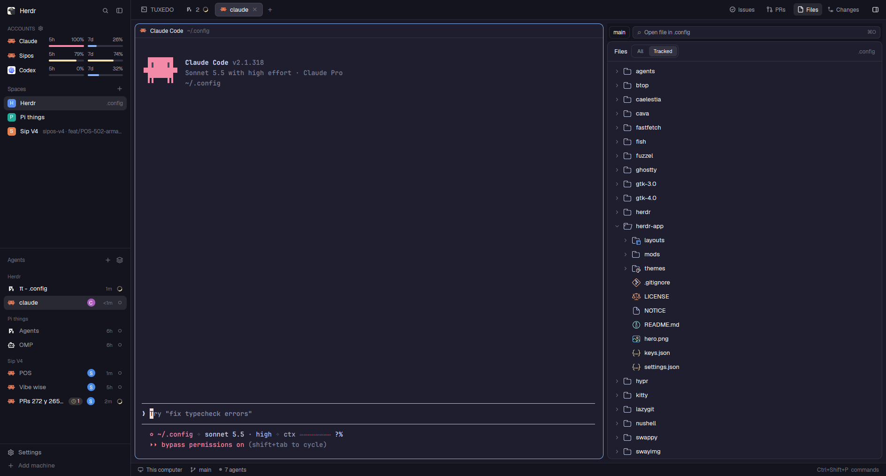

# herdr-dots

My [Herdr](https://herdr.dev) desktop app setup: the `piioni` layout and the mods behind it. Herdr's interface is
files, so this folder *is* the app.



## Mods

| Mod | What it is | Origin |
|---|---|---|
| [`relevo`](mods/relevo) | Accounts and their usage, launchers, handoff between accounts, the panel bar and Settings | [herdr-relevo](https://github.com/johnny4young/herdr-relevo) |
| [`better-sidebar`](mods/better-sidebar) | Spaces and agents in one block: pins, branch and PR per tab, minimizable spaces, account dots | [munza/herdr-mods](https://github.com/munza/herdr-mods/tree/main/better-sidebar) |
| [`prs`](mods/prs) | GitHub pull requests: a panel and a full PR dialog | mine |
| [`linear`](mods/linear) | Your Linear tickets as a panel | mine |
| [`tasks`](mods/tasks) | The scripts in a repo's `.tasks/` as background tasks | mine |
| [`shortcuts`](mods/shortcuts) | Every key binding in one searchable sheet | [tahadx/herdr-setup](https://github.com/tahadx/herdr-setup) |
| [`ion-files`](mods/ion-files) | File tree with file operations and Neovim | Herdr's `files` |
| [`ion-changes`](mods/ion-changes) | Uncommitted changes, scopes and a commit box | Herdr's `changes` |
| [`ion-diff`](mods/ion-diff) | A file's diff in a tab or popup | Herdr's `changes` |
| [`ion-tabs`](mods/ion-tabs) | The tab bar and the panel buttons | Herdr's `tabs` |

`ion-*` are clones: Herdr rewrites its shipped mods on every start, so changes have to live under another name.
Most mods have a README with screenshots, what they need and how to test them.

## Requirements

| Need | For |
|---|---|
| [`gh`](https://cli.github.com/), logged in | `prs`, PR status in `better-sidebar` |
| Linear API key in `~/.config/linear/token` | `linear`, the Linear chip in `prs` |
| `git`, `nvim` | `ion-*`, `tasks` |
| Claude Code and its hook in `mods/relevo/hooks` | account usage, account dots, background work |

`mods/relevo/config.js` holds my accounts and launchers: write your own, don't copy it.

## Install

Pick what you want and let your agent add it:

```text
Read ~/.config/herdr-app/AGENTS.md, then add mods from https://github.com/Piioni/herdr-dots to my Herdr
app. Go mod by mod: read its README, tell me what it does and ask before adding it. Never replace my
keys.json, settings.json or layouts without asking. For relevo, don't copy config.js: ask me which
accounts and launchers I have and write it with me. Ask before installing the Claude Code hook.
Never ask me to paste API keys in a command line.
```

## What is versioned

Only my own files: `.gitignore` is an allow-list. Herdr's shipped files, mod data and window state stay out.

## License

Apache 2.0, see [LICENSE](LICENSE) and [NOTICE](NOTICE). `shortcuts` is MIT (see its LICENSE).
