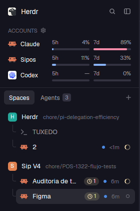

# better-sidebar

Spaces and agents in one sidebar block, with the Relevo account indicators, background work and a per-space launcher.



## What it does

One mod, several parts; `view` in the block's props picks one (`lists`, `agents`, `footer`, `panel-toggle`, or spaces
by default). The piioni layout uses `lists`: **Spaces** and **Agents** as two tabs with a quiet count.

- **Spaces**: grouped by machine, worktrees nested under their repo, each tab as a row with its program icon and agent
  status. Hovering a space shows a `+` that opens the Relevo launcher for that space.
- **Agents**: grouped, sorted and pinnable (pins are Herdr's `terminal.pin`, so every client sees them). Each agent row
  shows:
  - a small dot in its **account** color (from the `agent.account` label); on hover it turns into **Move**, which hands
    the conversation to another account (`relevo.handoff-agent-<address>`);
  - a **background work** capsule with a pulsing clock and a count while the agent has work running in the background
    (the `agent.bg` label);
  - how long it has been in its state, and its status.

## Why it exists

It replaces `relevo-agents` (Herdr's Agents list plus Relevo's extras). Better Sidebar was the better base: spaces and
agents together, grouping and pins. The Relevo pieces were brought over in a quieter form: dots instead of the big
lettered account badge.

## Where it comes from

[`better-sidebar`](https://github.com/munza/herdr-mods/tree/main/better-sidebar) from munza/herdr-mods (Apache-2.0),
v3.2.0, with these changes:

- Relevo integration: account dots, Move, the background-work capsule, the per-space launcher.
- Header, tab pills and rows polished (taller pills, divider under the tabs, row spacing, tooltips with name and
  program; the program name only shows when its icon is missing).
- Agent names ignore titles that are just a path.

## What it needs

- The [`relevo`](../relevo) mod for the launcher, accounts and Move. Without it the sidebar still works; those parts
  just don't show.
- The Claude Code hook in `mods/relevo/hooks` for the account dots and the background capsule (it sets the labels).
- `gh` for the PR status on spaces (optional).

## Test it

```sh
herdr-app check ~/.config/herdr-app/mods/better-sidebar
```
