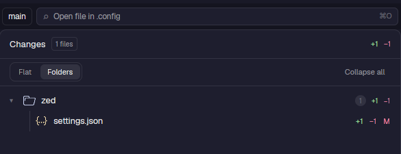

# ion-changes

Uncommitted changes of the folder you are working in (or a branch, or a commit), with a diff viewer in its own tab and a commit box.



## What it does

- Lists changed files with `+/-` counts and their status, as a **flat** list or grouped by **folders** (Collapse all).
  It refreshes by watching the folder.
- **Diff:** click a file to open its diff in the [`ion-diff`](../ion-diff) viewer in a tab (Shift-click: a dialog over the current
  one). On hover:
  - `open`: the file in Neovim.
  - `side-by-side`: the diff in Neovim (`git difftool` with `nvimdiff`, `diff.lua`), in a tab or (Shift) a popup. `u` there
    swaps to the *inline* view: your own Neovim with gitsigns (`inline.lua`), soft green/red bands, deleted lines inline,
    read-only, starting on the first change. `S` swaps back. `<leader>gW` toggles the word diff. Inline only compares the
    working tree against one ref, so a picked commit, a deleted file or a repo without commits stay side by side.
  - Both Neovim views are One Dark and share one statusline (`statusline.lua`), also used by your editor. One Dark comes
    from the `onedark.nvim` plugin (`~/.config/nvim/lua/plugins/onedark.lua`, which also makes it your editor's
    colorscheme); `onedark.lua` loads it for the side-by-side diff and sets the diff bands.
- **Scopes:** the box next to the file count chooses what is listed and diffed: *Uncommitted* (working tree vs `HEAD`),
  *Last commit* (plus what is uncommitted), *vs main* (everything since the branch left its base) or any one commit from
  the list. The choice is remembered per repo.
- **Commit box:** type a message and press Commit (or Enter): it runs `git add -A` then `git commit -m`. Failures are
  shown in place.
- Catppuccin Mocha file icons, shared with [`ion-files`](../ion-files).
- Git reads never write under `.git` (no index refresh, no lock), so the folder watch does not trigger itself.

## Why it exists

It is a clone of Herdr's `changes` mod (v0.1.12) reworked for daily use: diffs open in a tab instead of inline, a
folder view, icons and committing from the panel. Herdr overwrites its own mods on every start, so these edits live in a
clone.

## Where it is used

`layouts/piioni.json`: in the right-hand panel stack, between Files and PRs.

## Requirements

`git` on `PATH`; `nvim` for `open` and `nvim diff`.

## Files

| File | Role |
|---|---|
| `main.js` | The panel: list, views, commit box, diff launching |
| `terminal.js` | Neovim launchers and generic tab/popup helpers (`open`, `nvim diff`) |
| `diff.lua` | Neovim setup for the side-by-side diff tabs |
| `onedark.lua` | One Dark for the side-by-side diff (loads the plugin) and the diff bands of both |
| `argv.js`, `swap.lua` | The side-by-side command (tested); the `u` / `S` swap keys between side-by-side and inline |
| `inline.lua` | Inline diff in your own Neovim (gitsigns), loaded with `-c luafile` |
| `statusline.lua` | The statusline shared by your editor (`~/.config/nvim/lua/plugins/lualine.lua` loads it), the inline diff and the side-by-side diff |
| `icons.js`, `changes.svg` | File icons and the panel icon |

## Check

```sh
herdr-app check mods/ion-changes
```
